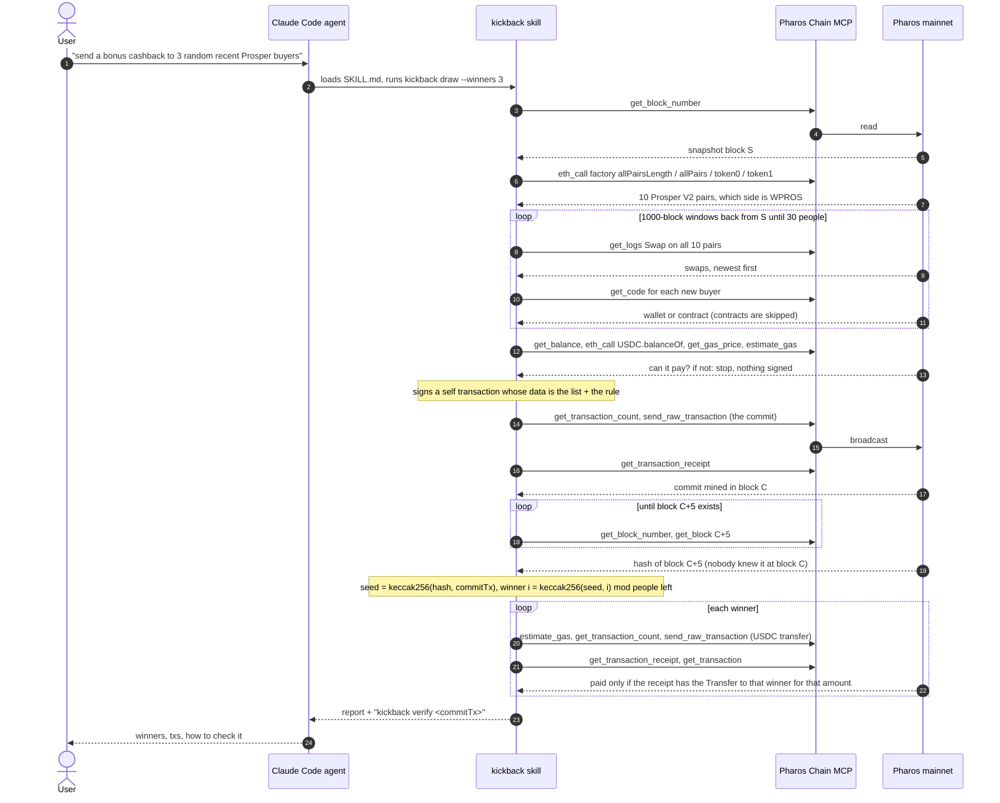

# How kickback works

One user request, one command, two tools that need each other: the **kickback skill** decides (who is in the
draw, when it is decided, who wins, whether a payout really happened) and the **Pharos Chain MCP**
(`mcp.pharos.xyz`) supplies every fact it decides on and carries every transaction it sends. Neither can do the
job alone: the MCP has the chain but no judgment and no key; the skill has the rules and the key but no chain.

## The flow, in the order it runs



Every one of those MCP calls is printed while it happens, one line each: `· [step] tool args  ms`,
and the whole ordered list is saved in the draw's JSON (`draws/<commitTx>.json`, field `calls`).

## Who decides what

| Decision | Made by | From which live data |
|---|---|---|
| Who counts as a buyer | skill | Swap logs of the 10 pairs (WPROS in), `get_code` per address |
| Who is left out | skill | contract code, the user's own wallet, repeats |
| Whether the run may go on | skill | PROS and USDC balances, gas price, gas estimates, the caps in `config.json` |
| Which block decides | skill | the commit receipt's block number + delay |
| Who wins | skill | the hash of that block (`get_block`) |
| Whether a winner was paid | skill | the payout receipt's Transfer log (USDC) or tx value (PROS) |
| Everything on chain | Chain MCP | reads, and `send_raw_transaction` for the four transactions |

## The commit

A transaction from the wallet to itself, value 0, data:

```
"kickback:1:" (11 bytes ASCII)
abi.encode(uint64 snapshot, uint16 delay, uint16 winners, address token, uint256 amountRaw, address[] pool)
```

`token` is USDC or the zero address for PROS. With 30 people it is 1,195 bytes.
Because the full list is inside, `kickback verify <commitTx>` needs nothing else: it decodes the tx, reads the
commit block, fetches block commit + delay, redoes the draw and looks for the payouts.

## Why the order matters

If the list were shown only after the deciding block, whoever runs the draw could look at the hash first and
then shape the list. Here the list is fixed on chain at block C, and the deciding block C + delay did not exist
yet. The one thing this does not cover: the validator producing block C + delay could in theory influence its
hash. kickback protects the participants from the person running the draw, not from the chain.

## Failure handling

- Anything wrong before the commit (bad parameters, over the cap, not enough USDC or PROS, fewer than 2 buyers):
  stop, nothing signed, exit 2.
- Every signed transaction is written to the draw's JSON before it is broadcast. `draw --resume <commitTx>`
  re-sends those exact bytes (same nonce, same hash), so a crash can never turn into a double payment.
- A payout whose simulation keeps reverting is marked FAILED and the run carries on with the others. No
  replacement winner is drawn: that would be a second rule to trust.

## Files

| File | What it holds |
|---|---|
| `src/chain.ts` | the `Chain` interface over Chain MCP tools, the call journal, tapes for tests |
| `src/mcp.ts` | the Chain MCP client (Streamable HTTP, paced under 120 calls/min) |
| `src/buyers.ts` | Prosper V2 pairs, Swap decoding, the pool walk |
| `src/commit.ts` | commit encode/decode |
| `src/lottery.ts` | seed and winner picking |
| `src/params.ts` | defaults, limits, caps |
| `src/pay.ts` | signing, broadcast and wait, payout check |
| `src/flow.ts` | the draw, step by step, and resume |
| `src/verify.ts` | the draw redone from one tx |
| `src/cli.ts` | commands and the live printout |
