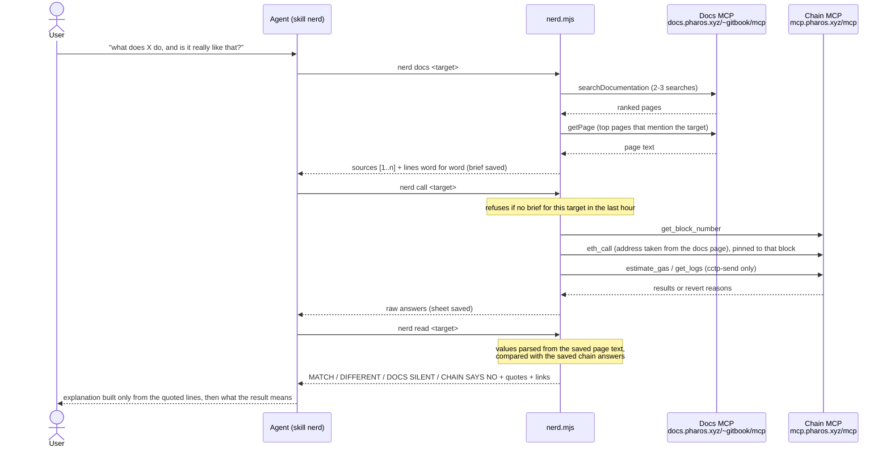

# nerd: how it works

## Pieces

| File | Job |
|---|---|
| `src/mcp.ts` | one paced MCP client class for both servers; every answered call goes to the live trace |
| `src/docs.ts` | search -> open pages -> keep the lines that mention the target, verbatim, with page and link |
| `src/facts.ts` | pulls the docs' concrete values out of page text: x402 EIP-712 name, version, network, token, decimals, worked example, prices; CCTP transmitter, domain, finality line, header offset table |
| `src/chain.ts` | eth_call that keeps reverts as answers, estimate_gas, get_logs in 1,000-block windows, blocks with transactions |
| `src/subjects.ts` | each target: what to search for, what to call, how to judge; the latest-block walk |
| `src/store.ts` | briefs and sheets on disk, the docs-first rule |
| `src/cli.ts` | `docs`, `call`, `read`, `first` |

## Where each value comes from

| Value | Source |
|---|---|
| contract address called | parsed from the docs page (x402: "USDC token address", CCTP: the MessageTransmitterV2 row for Pharos) |
| expected EIP-712 separator | keccak of the docs' name, version, chain id and token, computed by nerd |
| destination, sender, body of the simulated message | the user's request |
| min finality threshold | the user's request, else the docs' "finalized" number |
| header offsets used to cut a real message | the docs' Message Header table |
| what a real message looks like | the newest `MessageSent` log on the contract, via Chain MCP |

## Decisions

- Facts are parsed at run time, never typed in. If the docs change, the readings change with them.
- `askQuestion` is left out on purpose: it is a language model and can answer from general knowledge.
- The docs-first rule lives in the tool (`call` exits with code 2 without a fresh brief), so an agent can't
  skip it by accident.
- A revert is an answer, not an error: `CHAIN SAYS NO` with the contract's own reason.
- Nothing signs. The simulated `sendMessage` is the closest nerd gets to a write.
