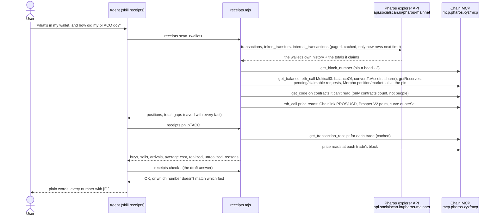

# receipts: how it works

## The pieces

| File | What it does |
|---|---|
| `explorer.ts` | Pages through the explorer's three history lists, caches them per wallet, fetches only what is new on the next scan, and records how many rows it served against how many it says exist. |
| `mcp.ts` | One Chain MCP session, paced under the server's rate limit. An allowlist of read tools: `send_raw_transaction` is refused before it leaves the machine. |
| `chain.ts` | The pinned block, Multicall3 batches, token metadata, and transaction receipts turned into transfers, wraps and request ids. Receipts are cached; an explorer amount that disagrees with the receipt loses to it. |
| `flows.ts` | Groups the history by transaction: who sent it, to which contract, which method, what went out and what came in (native PROS included, from tx value and internal transfers). |
| `adapters.ts` | From "touched these tokens and contracts" to "holds these positions now": tokens, ERC-4626 and ERC-7540 shares, V2 pool shares, Morpho Blue, vault requests in flight, and contracts it can't read. |
| `prices.ts` | A USD price for a token at a block: USDC, Chainlink PROS/USD, Prosper V2 pair, Prosper curve `quoteSell`, ERC-4626 share. Each route that fails is named in the reason. |
| `lots.ts` | One token's story: bought, received, sold, sent, with average cost, realized and unrealized profit; withheld when the history doesn't add up to the chain balance or a trade can't be priced. Vault earnings in the vault's own asset. |
| `facts.ts` | The ledger: every number is a fact (`F7`) with contract, call or tx, block and source; every gap is an unknown with one of eight reasons. |
| `check.ts` | Reads an answer, finds every number, and matches it against the facts cited on that line (sums, differences, products, ratios and percent changes of cited facts are allowed; so is rounding to what was shown). |
| `scan.ts`, `answers.ts`, `cli.ts` | One saved scan per wallet at one block; the answers built from it; the command line. |

## Rules it keeps

- One pinned block per scan. Every read in a scan uses it; questions afterwards reuse the saved scan.
- The explorer decides what to look at; the chain decides the amounts.
- No number without a fact; no "can't tell" without a reason.
- No signing code, no keys, no sends. The test suite greps the source for them.
